<a href="https://github.com/adawo-kai"><picture><source media="(prefers-color-scheme: dark)" srcset="assets/hero-dark.svg"></picture></a>

  <a href="https://t.me/adawo_creator" title="@adawo_creator"><picture><source media="(prefers-color-scheme: dark)" srcset="assets/btn-telegram-dark.svg"></picture></a>
  <a href="mailto:alisherov.ilim99@gmail.com" title="alisherov.ilim99@gmail.com"><picture><source media="(prefers-color-scheme: dark)" srcset="assets/btn-gmail-dark.svg"></picture></a>

I'm Adawo. Java and Spring Boot are home base; around them I build the web with React, Next.js and Astro, and make motion design and 3D with code: GSAP, Blender, FFmpeg.

<picture><source media="(prefers-color-scheme: dark)" srcset="assets/h-room-dark.svg">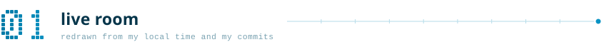</picture>

<picture><source media="(prefers-color-scheme: dark)" srcset="assets/room-dark.svg"></picture>

<b>How does the room work?</b>

 

- <b>The window</b> is my local time (UTC+6): dawn, day, dusk or night with a moon and stars.
- <b>The weather is my commits.</b> No contributions for a week and the sky is overcast; ten or more and it is clear. A commit today sends a shooting star across the night sky.
- <b>The monitor</b> shows the repository I pushed to last. Two quiet weeks and it falls asleep.
- <b>The books</b> are my languages, each as tall as its share of my public code. <b>The plant</b> grows a leaf for every dozen contributions.
- <b>The clock and the calendar</b> show the minute the picture was drawn.
- No server and no trackers: <a href="scripts/live_parts.py"><code>scripts/live_parts.py</code></a> draws plain SVG from the public GitHub API, and <a href="scripts/build.py"><code>scripts/build.py</code></a> redraws everything in one run.

<picture><source media="(prefers-color-scheme: dark)" srcset="assets/h-mountains-dark.svg">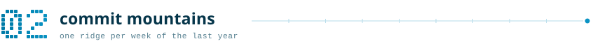</picture>

<picture><source media="(prefers-color-scheme: dark)" srcset="assets/mountains-dark.svg"></picture>

<picture><source media="(prefers-color-scheme: dark)" srcset="assets/h-stack-dark.svg">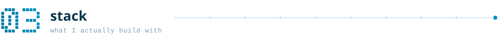</picture>

<picture><source media="(prefers-color-scheme: dark)" srcset="assets/stack-dark.svg"></picture>

<picture><source media="(prefers-color-scheme: dark)" srcset="assets/h-work-dark.svg">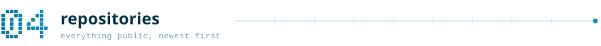</picture>

<picture><source media="(prefers-color-scheme: dark)" srcset="assets/numbers-dark.svg">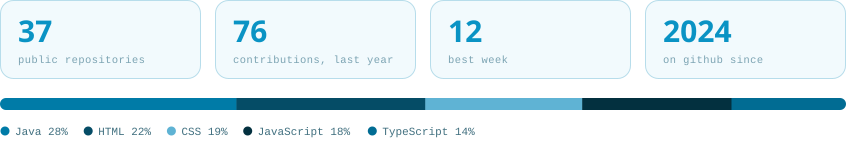</picture>

  <a href="https://github.com/adawo-kai/liketime-app" title="liketime-app"><picture><source media="(prefers-color-scheme: dark)" srcset="assets/card-1-dark.svg">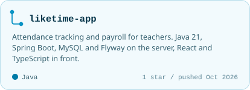</picture></a>
  <a href="https://github.com/adawo-kai/depak-fashion" title="depak-fashion"><picture><source media="(prefers-color-scheme: dark)" srcset="assets/card-2-dark.svg">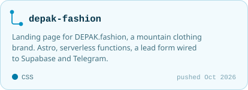</picture></a>

  <a href="https://github.com/adawo-kai/NexusFlow" title="NexusFlow"><picture><source media="(prefers-color-scheme: dark)" srcset="assets/card-3-dark.svg">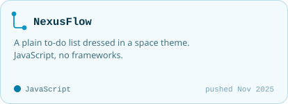</picture></a>
  <a href="https://github.com/adawo-kai/sky-journey-tour" title="sky-journey-tour"><picture><source media="(prefers-color-scheme: dark)" srcset="assets/card-4-dark.svg"></picture></a>

<b>All 37 public repositories</b>

 

<table>
<tr><th align="left">repository</th><th align="left">language</th><th align="left">last push</th></tr>
<tr><td><a href="https://github.com/adawo-kai/liketime-app" title="LikeTime: учёт посещаемости и расчёт зарплаты преподавателей"><b>liketime-app</b></a></td><td>Java</td><td>Oct&nbsp;2026</td></tr>
<tr><td><a href="https://github.com/adawo-kai/liketime" title=""><b>liketime</b></a></td><td></td><td>Oct&nbsp;2026</td></tr>
<tr><td><a href="https://github.com/adawo-kai/depak-fashion" title="Лендинг бренда одежды для горных походов DEPAK.fashion (Бишкек), Astro"><b>depak-fashion</b></a></td><td>CSS</td><td>Oct&nbsp;2026</td></tr>
<tr><td><a href="https://github.com/adawo-kai/demo_001" title=""><b>demo_001</b></a></td><td></td><td>Oct&nbsp;2026</td></tr>
<tr><td><a href="https://github.com/adawo-kai/rock" title=""><b>rock</b></a></td><td>HTML</td><td>Sep&nbsp;2026</td></tr>
<tr><td><a href="https://github.com/adawo-kai/chislo" title=""><b>chislo</b></a></td><td>JavaScript</td><td>Sep&nbsp;2026</td></tr>
<tr><td><a href="https://github.com/adawo-kai/web_automatwow" title=""><b>web_automatwow</b></a></td><td></td><td>Apr&nbsp;2026</td></tr>
<tr><td><a href="https://github.com/adawo-kai/p_004" title=""><b>p_004</b></a></td><td>Java</td><td>Apr&nbsp;2026</td></tr>
<tr><td><a href="https://github.com/adawo-kai/web_001" title="demo shop"><b>web_001</b></a></td><td>JavaScript</td><td>Apr&nbsp;2026</td></tr>
<tr><td><a href="https://github.com/adawo-kai/Unique_NUM" title="English: We built a program that creates a list of numbers from 0 to 146, randomly removes 46 numbers, and then repeatedly generates a random group of 5 until it includes 144. The number 144 is treated exactly like all other numbers, with no special selection rules."><b>Unique_NUM</b></a></td><td></td><td>Mar&nbsp;2026</td></tr>
<tr><td><a href="https://github.com/adawo-kai/A006-T000" title=""><b>A006-T000</b></a></td><td>Java</td><td>Feb&nbsp;2026</td></tr>
<tr><td><a href="https://github.com/adawo-kai/jetihub-website" title=""><b>jetihub-website</b></a></td><td></td><td>Feb&nbsp;2026</td></tr>
<tr><td><a href="https://github.com/adawo-kai/A006-Sanji" title=""><b>A006-Sanji</b></a></td><td>Java</td><td>Feb&nbsp;2026</td></tr>
<tr><td><a href="https://github.com/adawo-kai/progress4points" title=""><b>progress4points</b></a></td><td></td><td>Feb&nbsp;2026</td></tr>
<tr><td><a href="https://github.com/adawo-kai/hw" title=""><b>hw</b></a></td><td>JavaScript</td><td>Feb&nbsp;2026</td></tr>
<tr><td><a href="https://github.com/adawo-kai/simple-clicker-in-react" title=""><b>simple-clicker-in-react</b></a></td><td>JavaScript</td><td>Jan&nbsp;2026</td></tr>
<tr><td><a href="https://github.com/adawo-kai/B001_Argus_Prototype" title=""><b>B001_Argus_Prototype</b></a></td><td></td><td>Jan&nbsp;2026</td></tr>
<tr><td><a href="https://github.com/adawo-kai/C-_prj1-Calculator" title="my first project using C#"><b>C-_prj1-Calculator</b></a></td><td>C#</td><td>Dec&nbsp;2025</td></tr>
<tr><td><a href="https://github.com/adawo-kai/final-avanto-models" title=""><b>final-avanto-models</b></a></td><td></td><td>Dec&nbsp;2025</td></tr>
<tr><td><a href="https://github.com/adawo-kai/avanto-models-1.0" title=""><b>avanto-models-1.0</b></a></td><td>JavaScript</td><td>Dec&nbsp;2025</td></tr>
<tr><td><a href="https://github.com/adawo-kai/B001_Argus" title="A self-contained campus private network connecting multiple devices to a central server, providing internal web services, file sharing, and core network infrastructure without relying on external internet access."><b>B001_Argus</b></a> fork</td><td>C++</td><td>Dec&nbsp;2025</td></tr>
<tr><td><a href="https://github.com/adawo-kai/web_final_2course" title=""><b>web_final_2course</b></a></td><td>JavaScript</td><td>Dec&nbsp;2025</td></tr>
<tr><td><a href="https://github.com/adawo-kai/NexusFlow" title="Обычный список дел, но в крутом космическом стиле!"><b>NexusFlow</b></a></td><td>JavaScript</td><td>Nov&nbsp;2025</td></tr>
<tr><td><a href="https://github.com/adawo-kai/A004" title="Answer to the question on the &quot;WORD&quot;, 9question"><b>A004</b></a></td><td></td><td>Nov&nbsp;2025</td></tr>
<tr><td><a href="https://github.com/adawo-kai/sky-journey" title="Sample for P334"><b>sky-journey</b></a> fork</td><td>JavaScript</td><td>Nov&nbsp;2025</td></tr>
<tr><td><a href="https://github.com/adawo-kai/jeti_portfolio2026" title=""><b>jeti_portfolio2026</b></a></td><td>HTML</td><td>Nov&nbsp;2025</td></tr>
<tr><td><a href="https://github.com/adawo-kai/portfolio__-2025" title=""><b>portfolio__-2025</b></a></td><td>HTML</td><td>Nov&nbsp;2025</td></tr>
<tr><td><a href="https://github.com/adawo-kai/portfolio2026" title=""><b>portfolio2026</b></a></td><td>HTML</td><td>Nov&nbsp;2025</td></tr>
<tr><td><a href="https://github.com/adawo-kai/portfolio_2025re" title="remake"><b>portfolio_2025re</b></a></td><td>HTML</td><td>Nov&nbsp;2025</td></tr>
<tr><td><a href="https://github.com/adawo-kai/todo-list" title=""><b>todo-list</b></a></td><td>Java</td><td>Nov&nbsp;2025</td></tr>
<tr><td><a href="https://github.com/adawo-kai/portfolio-2025" title="my own portfolio end of 2025"><b>portfolio-2025</b></a></td><td>HTML</td><td>Nov&nbsp;2025</td></tr>
<tr><td><a href="https://github.com/adawo-kai/sky-journey-tour" title="Not Switzerland, but feels like it - with more heart. Exclusive access to Kazakhstan's best winter destinations with no crowds, just pure alpine magic"><b>sky-journey-tour</b></a></td><td>HTML</td><td>Nov&nbsp;2025</td></tr>
<tr><td><a href="https://github.com/adawo-kai/portfolio" title=""><b>portfolio</b></a></td><td>HTML</td><td>Oct&nbsp;2025</td></tr>
<tr><td><a href="https://github.com/adawo-kai/wishbone" title=""><b>wishbone</b></a></td><td>HTML</td><td>Oct&nbsp;2025</td></tr>
<tr><td><a href="https://github.com/adawo-kai/my-s1mple-profile" title="my own portfolio "><b>my-s1mple-profile</b></a></td><td>HTML</td><td>Oct&nbsp;2025</td></tr>
<tr><td><a href="https://github.com/adawo-kai/A1-Construction" title=""><b>A1-Construction</b></a></td><td></td><td>Oct&nbsp;2025</td></tr>
<tr><td><a href="https://github.com/adawo-kai/simple-game-store" title=""><b>simple-game-store</b></a></td><td>HTML</td><td>Sep&nbsp;2025</td></tr>
</table>

<picture><source media="(prefers-color-scheme: dark)" srcset="assets/h-snake-dark.svg">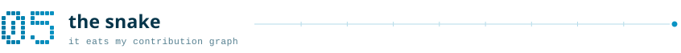</picture>

<picture><source media="(prefers-color-scheme: dark)" srcset="assets/snake-dark.svg"></picture>

<picture><source media="(prefers-color-scheme: dark)" srcset="assets/footer-dark.svg"></picture>
